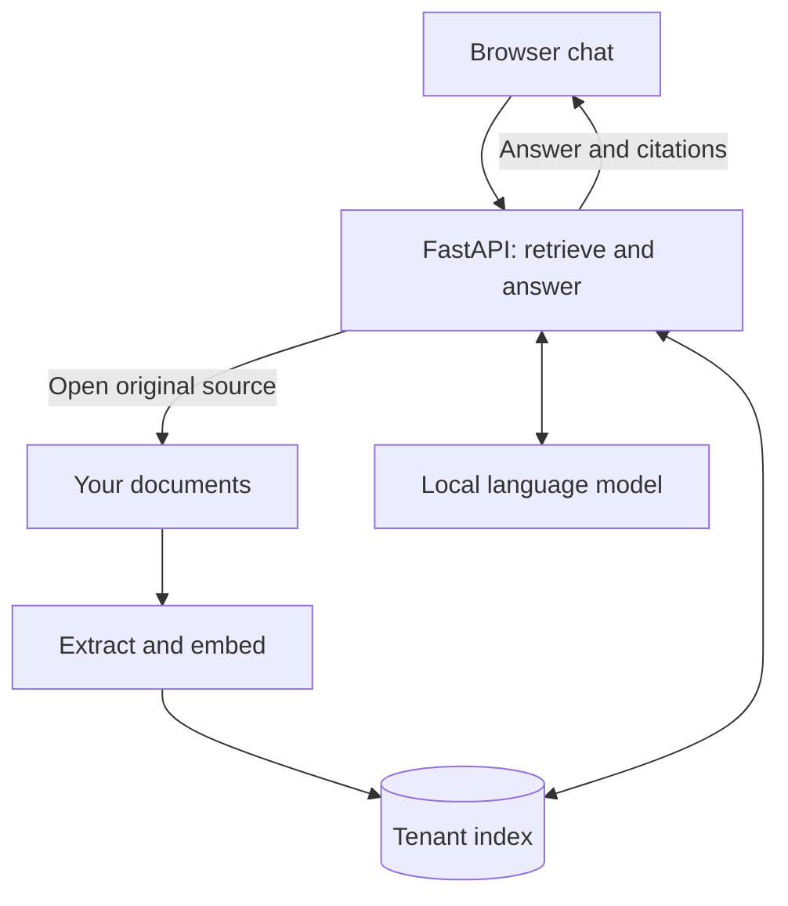

<div align="center">

<h1>Hebrew-English RAG Application</h1>

<p>Search your documents. Ask in Hebrew or English. Follow the answer back to its sources.</p>

<p>
  
  
  
</p>

<p>
  <a href="#how-it-works">How it works</a> ·
  <a href="#features">Features</a> ·
  <a href="#quick-start">Quick start</a> ·
  <a href="docs/INSTALLATION.md">Installation</a> ·
  <a href="docs/ARCHITECTURE.md">Architecture</a>
</p>

</div>

Hebrew-English RAG Application is a local workspace for searching files, asking questions, and reviewing the evidence behind an answer. It combines a bilingual browser interface, document ingestion, semantic and keyword retrieval, and a local language model.

You create your own knowledge bases and add your own documents. Each knowledge base has a tenant ID that keeps its index, source files, and conversation context separate. The repository starts with no tenants, documents, or prebuilt indexes.

## How it works



Ingestion turns documents into searchable passages with source metadata. For each question, the backend retrieves evidence from the selected knowledge base and returns an answer with its source references. See the [architecture guide](docs/ARCHITECTURE.md) for the components, data flow, and tenant boundaries.

## Features

| Feature | What you can do |
|---|---|
| **Hebrew and English** | Switch the interface between Hebrew and English, with right-to-left and left-to-right layouts. Ask questions in either language. |
| **Document chat** | Ask for summaries, compare sources, find a figure or date, and continue with follow-up questions. |
| **Source citations** | Review the evidence attached to an answer and open the corresponding original document. |
| **Hybrid retrieval** | Search with multilingual embeddings and lexical matching, with optional reranking. |
| **Document ingestion** | Index PDFs, DOCX, XLSX, PPTX, text, Markdown, and structured text files. Add Tesseract for scanned documents and image OCR. |
| **Your own knowledge bases** | Configure separate document collections and select the one you want to query in the browser. |

## Quick start

Use **Linux x86-64 (including WSL2), Python 3.12, llama-server b12110, and an instruction-tuned GGUF model**. The [full installation guide](docs/INSTALLATION.md) includes the model download and server build if you are starting from scratch.

### 1. Install

```bash
git clone https://github.com/Doron126/hebrew-english-rag.git
cd hebrew-english-rag
python3.12 -m venv .venv
. .venv/bin/activate
python -m pip install --no-deps -r requirements-cpu.txt
python -m pip install -r requirements.lock.txt
```

### 2. Configure your workspace

Replace the two model paths with your local files:

```bash
python manage.py init \
  --llama-server "/absolute/path/to/llama-server" \
  --model "/absolute/path/to/instruction-model.gguf" \
  --data-dir "$HOME/hebrew-english-rag-data" \
  --embedding-model intfloat/multilingual-e5-small

python manage.py tenant add my-documents --name "My documents"
```

The setup creates local configuration and prints your new document directory. Copy your own files into `~/hebrew-english-rag-data/documents/my-documents/`. You can choose a different tenant ID and display name.

### 3. Index and start

```bash
python manage.py ingest --tenant my-documents
python manage.py doctor
python manage.py serve
```

Open **[http://127.0.0.1:18080](http://127.0.0.1:18080)** and select **My documents** in Settings. The launcher starts the local model and the web application together. Press **Ctrl+C** to stop them; your files and index remain available for the next session.

## Working with your documents

Choose a knowledge base in **Settings** and begin with a summary that names an indexed file, including its extension. Replace the example filenames below with your own exact filenames:

| English | עברית |
|---|---|
| Summarize report.pdf. | סכם את report.pdf. |
| What are the main findings in report.pdf? | מהם הממצאים המרכזיים בקובץ report.pdf? |
| Compare report.pdf and update.pdf, citing both files. | השווה בין report.pdf לבין update.pdf והוסף הפניות לשני הקבצים. |

Use follow-up questions to narrow the scope. Open a source citation to review the original context, or export the conversation as Markdown to keep your notes.

## Documentation

| Guide | Contents |
|---|---|
| [Installation and first use](docs/INSTALLATION.md) | Requirements, model setup, your first tenant, ingestion, startup, and troubleshooting |
| [Architecture](docs/ARCHITECTURE.md) | Components, retrieval and generation, source access, and persistence |

## Author

Created by **Doron Shamo**.
