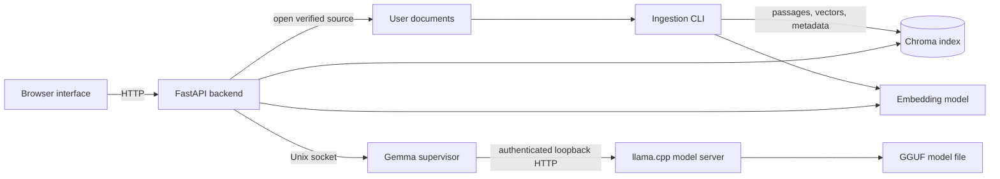

# Architecture

The application extracts text from a user's documents, divides it into searchable passages, and stores passage embeddings and metadata in a tenant-scoped index. A question is matched against that index; the backend assembles evidence and may use a separately managed local language model to produce an answer. Citations identify evidence and, when source metadata remains valid, link back to original files. Some requests take deterministic extraction, fallback, partial-answer or abstention paths instead of model generation. Answers and document extraction can be incomplete or wrong.

The browser, API, ingestion CLI and generation server have separate process boundaries. Embedding and optional reranking models run in the Python process that uses them. The supervisor owns the model server lifecycle and resource admission; the API does not start the model directly. The client socket can be configured independently with `GEMMA_SUPERVISOR_SOCKET`. The supervisor accepts its listening socket from systemd through file descriptor 3, so its address must be supplied by a matching `.socket` unit; setting the client variable does not create that unit or configure the supervisor. Those deployment units are not included. The existing supervisor is tied to a specific WSL profile, and this publication has placeholders for its former machine paths. A portable new model deployment is not supplied; see [installation](INSTALLATION.md).

| Responsibility | Source | Configuration or data |
|---|---|---|
| Browser interface and source navigation | `index.html`, `app.js`, `frontend_policy.js` | Browser local storage holds UI settings and conversations |
| API, question orchestration, tenant selection and readiness | `chat_api.py` | `APP_ENV`, `TENANT_AUTH_MODE`, `LOCAL_ALLOWED_TENANTS`, `WARMUP_TENANTS`, `DOCS_BASE_DIR` |
| Document ingestion and extraction | `ingest.py`, `pdf_reconstruction.py`, `pdf_layout.py`, `canonical_text.py`, `splitter.py` | User-owned document directory, extraction audit, `CHROMA_PATH`, `EMBED_MODEL` |
| Embeddings and retrieval | `embedder.py`, `retriever.py`, `config_env.py` | Chroma collections and source/chunk metadata; embedding and optional reranking model cache |
| Evidence and answer processing | `evidence_context.py`, `evidence_synthesis.py`, `semantic_answer_quality.py`, `source_structure.py`, `chat_api.py` | Retrieved evidence, request history and validation settings |
| Conversation context | `conversation_state.py`, `conversation_documents.py` | In memory by default; optional SQLite path `PROJECT_X_CONVERSATION_STATE_PATH` |
| Original-source resolution | `source_access.py`, `source_authorization.py`, `chat_api.py` | Tenant-relative document path, opaque source ID, file stat and SHA-256 metadata |
| Model client, supervisor and process | `gemma_client.py`, `gemma_app.py`, `gemma_supervisor.py` | Client socket `GEMMA_SUPERVISOR_SOCKET`, supervisor socket, operator tenant allow-list, runtime profile and separately obtained GGUF model |

## Ingestion

1. An operator chooses a tenant ID and places files in its own directory under `DOCS_BASE_DIR`. The ingestion CLI receives that ID and directory explicitly. The UI does not upload files.
2. `ingest.py` discovers supported files and extracts text using format-specific handling. PDF handling can use text extraction and optional OCR; Office formats are parsed from their internal document structures. Files that cannot be safely extracted are reported as failures or no text.
3. `canonical_text.py` and `splitter.py` prepare text and chunks, preserving structural and source metadata where available. The embedding model converts passages to vectors.
4. Chroma stores vectors, text and metadata in a tenant collection by default, or a shared collection with tenant metadata if configured. An opaque source ID and source-relative path connect indexed passages to their originals. Indexing can write extraction audit data separately.
5. CLI output and an optional JSON report show processed, indexed, unchanged, empty and failed files. Content fingerprints allow unchanged files to be skipped. Reconciliation options for deleted or rebuilt sources are explicit; failures prevent global cleanup in the guarded paths. They are not required for initial ingestion.

Default file extensions and limits are defined in `ingest.py`. OCR is optional and quality varies, particularly for scans, graphics and complex tables. The index contains extracted document content and is sensitive user data.

## Question answering

1. The browser sends the question, tenant selection and relevant conversation context to `/chat` in `chat_api.py`. A request is resolved to an effective tenant using the configured tenant boundary.
2. `retriever.py` searches the tenant's Chroma data using embeddings and lexical methods; optional reranking can reorder candidates. Evidence and source metadata are prepared for the requested scope.
3. The backend routes some requests through deterministic document-specific extraction or evidence processing. Where generation is appropriate, `gemma_client.py` calls `gemma_app.py`, which sends a tenant-bound request over a Unix socket to `gemma_supervisor.py`; the supervisor communicates with its local llama.cpp server. A model response is not a guarantee of factual support.
4. The backend applies answer, evidence and citation processing. Unsupported evidence can lead to partial results, fallback text or abstention. The response and citation information are delivered to the browser. Follow-up state is tenant-bound and can include prior turns and source selections.

This is a high-level view: request routing and validation branches are implemented across the modules in the table. Not every path invokes the model, and a successful liveness response does not establish retrieval or model readiness.

## Tenants, sources and access

In local WSL client mode, the operator configures `LOCAL_ALLOWED_TENANTS`; the API validates a selected ID against that list. The supervisor separately checks `PROJECTX_GEMMA_TENANTS`. Collection naming or tenant metadata scopes index access. Source access resolves a source ID from tenant-scoped metadata, opens a relative path beneath the tenant document root, and checks stored file information and SHA-256 before streaming the original. Changes to the file can invalidate a source link until re-ingestion.

Tenant selection and filtering do not by themselves authenticate a person. Client selection is limited to loopback in local mode. The alternative trusted-header mode relies on an external trusted identity boundary that supplies authorized tenant claims; the application code does not turn an arbitrary client header into verified identity. This publication does not supply a complete multiuser authentication deployment.

## Persistence and runtime behavior

Original files remain under `DOCS_BASE_DIR/<tenant-id>`; ingestion does not copy them into a document store. Chroma under `CHROMA_PATH` persists chunks, embeddings and source metadata. Model assets are downloaded separately and cached by their respective tooling. Extraction audits and ingestion reports can contain sensitive document-derived information. Backend conversation state is in memory unless `PROJECT_X_CONVERSATION_STATE_PATH` configures SQLite; browser history is stored separately in browser local storage. The supervisor manages its own runtime state and logs. Temporary processing and operating-system caches are not a substitute for the original files.

Hebrew search normalization in `config_env.py` handles certain writing and punctuation differences, while multilingual E5 embeddings provide semantic retrieval across supported languages. These mechanisms do not guarantee coverage or translation accuracy. The generation supervisor enforces profile-specific memory, GPU and tenant checks, and requires a compatible separately installed model runtime. The publication preserves those checks but does not make that fixed profile portable. Treat this as an experimental reference, verify citations against originals, and consult the [installation guide](INSTALLATION.md) for current setup limitations.
