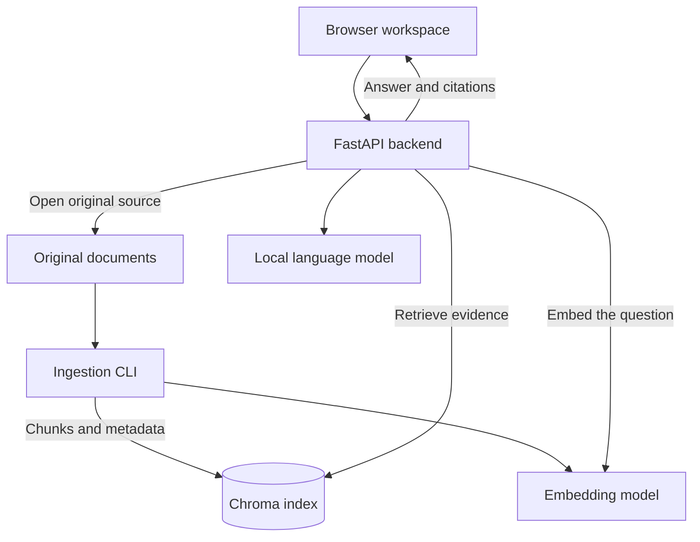

# Architecture

Hebrew-English RAG Application connects a browser workspace to a Python backend, a tenant-scoped document index, and a local language model. Documents are indexed ahead of time. Questions use the selected knowledge base to retrieve evidence, prepare an answer, and link back to the original files.

## Components

The browser, backend, ingestion command, and generation server have separate process boundaries. Embedding and optional reranking models run in the Python process that uses them. Chroma persists the searchable data on disk.

| Component | Main files | Responsibility |
|---|---|---|
| Local setup and lifecycle | `manage.py` | Installation configuration, tenant creation, ingestion commands, and starting or stopping the local processes |
| Browser workspace | `index.html`, `app.js`, `ui-language.js`, `frontend_policy.js` | Hebrew and English layouts, conversations, knowledge-base selection, answers, and source navigation |
| Application API | `chat_api.py` | Tenant resolution, request routing, evidence preparation, answer processing, and readiness |
| Ingestion | `ingest.py`, `pdf_reconstruction.py`, `pdf_layout.py`, `canonical_text.py`, `splitter.py` | File discovery, text extraction, normalization, chunking, and indexing |
| Retrieval | `embedder.py`, `retriever.py`, `config_env.py` | Multilingual embeddings, vector and lexical search, and optional reranking |
| Evidence processing | `evidence_context.py`, `evidence_synthesis.py`, `semantic_answer_quality.py`, `source_structure.py` | Evidence selection, document structure, answer checks, and citation context |
| Local file summaries | `local_summary.py` | Model selection of original source sentences or bullet points, each paired with a supplied citation ID |
| Conversation context | `conversation_state.py`, `conversation_documents.py` | Tenant-bound follow-up state and prior document selections |
| Original sources | `source_access.py`, `source_authorization.py` | Source IDs, tenant-relative paths, file validation, and original-document access |
| Local generation | `local_llama_client.py`, `llm_client.py` | Authenticated local model requests, token budgets, readiness, and runtime communication |
| Supervised runtime adapter | `gemma_client.py`, `gemma_app.py`, `gemma_supervisor.py` | Connection to an existing supervised Gemma deployment |

## Document ingestion

1. **Choose a knowledge base.** A tenant ID identifies a collection of documents. Its original files live beneath `DOCS_BASE_DIR/<tenant-id>`. The ingestion command receives the ID and document directory explicitly.
2. **Extract the content.** Format-specific handlers read PDFs, Office documents, text, and other supported formats. PDF and image processing can use optional OCR. Extracted text carries page, sheet, row, or other location metadata where available.
3. **Prepare searchable passages.** Text normalization and chunking turn the extraction into passages. The configured embedding model converts each passage into a vector.
4. **Write the index.** Chroma stores passage text, embeddings, source metadata, and tenant information. The default strategy creates a separate collection for each tenant. A shared-collection strategy also exists and uses tenant metadata filtering.
5. **Report the result.** Console output and the optional JSON report show indexed, unchanged, empty, skipped, and failed files. Content fingerprints support incremental ingestion. Explicit reconciliation flags handle obsolete entries after a successful scan.

Original files stay in their document directory. The application uses them for source links and document-specific processing, so keep them alongside the index. If you edit a document, rerun ingestion to update its passages and source metadata. Extraction audits and reports may contain text derived from the documents.

The embedding model must match between ingestion and retrieval. Changing it requires rebuilding the affected index. OCR quality and available document structure determine what can be extracted from scans, tables, and graphics; the ingestion report records files that need attention.

## From a question to an answer

1. The browser sends the question, selected tenant, and conversation context to `POST /chat`. The backend resolves the effective tenant before reading documents or index records.
2. Retrieval combines multilingual embeddings with lexical matching. Optional reranking reorders candidates. Document-specific routes can also read structured content from the original files.
3. The backend assembles the relevant evidence. Some requests use deterministic extraction or calculation; others use the language model to interpret or summarize that evidence. A request may involve more than one model call.
4. Answer and citation processing produces the browser response. It can contain a complete or partial answer, a request for clarification, or an indication that the available evidence is insufficient. Follow-up context remains bound to the tenant and conversation.

The response includes the answer text, effective tenant, citation records, and response status. Citations can include a display name, excerpt, page or other location, and a server-generated URL for the original file. These checks help connect answers to evidence; the original document remains the reference for reviewing the result.

For ordinary summaries that name an indexed file, `local_summary.py` asks the local model to choose original source sentences or complete bullet points. The constrained response pairs each selection with its supplied citation ID. Source authorization and quote eligibility establish the available evidence; source reconstruction, citation, coverage, and factual checks govern the final answer. The summary therefore keeps the source wording and gives each selected point a traceable reference.

## Generation runtime

The local setup selects `RAG_MODEL_RUNTIME=llama_cpp`. The generation model runs in a separate `llama-server` process, with its GGUF file and executable chosen during initialization. The Python application uses `LLAMA_BASE_URL`, `LLAMA_MODEL_ID`, and `LLAMA_API_KEY_FILE` to connect to it. Model files and server binaries are obtained separately from their upstream projects.

`python manage.py serve` starts the model server, waits for its health check, and then starts FastAPI. The default addresses are `127.0.0.1:18081` for the model and `127.0.0.1:18080` for the application. Initialization creates a private API key file for the connection between these processes. The launcher reads the installation's `.env`, passes that configuration to both processes, and keeps model output in the data directory's `logs/model.log`.

The local adapter checks the server's health, loaded model alias, and context capacity. It uses the server's chat template and tokenizer to check that a prompt, output budget, and reserved context fit before generation. The adapter observes the model server; process ownership belongs to the launcher.

The default setup uses CPU embeddings and CPU generation, with a 4,096-token model context. A GPU-enabled llama.cpp build can offload the number of layers selected through `--gpu-layers` at initialization. Model size, context, and available RAM or GPU memory determine the resources required.

Pressing Ctrl+C in the launcher's terminal stops both processes it started. The document index, original files, model cache, and conversation database persist across restarts. The [installation guide](INSTALLATION.md) covers setup, model selection, configuration changes, and daily use.

The original supervised Gemma adapter remains available with `RAG_MODEL_RUNTIME=supervised`, which is also the fallback when the setting is absent. It uses its separately managed supervisor and deployment configuration. New installations created by `manage.py init` explicitly select the local llama.cpp runtime described above.

## Tenants and source access

In the documented local mode, `LOCAL_ALLOWED_TENANTS` defines the knowledge bases available to the operator. The browser selects an ID from that list. The backend applies the same tenant boundary to chat, document listings, readiness, and source access. The default Chroma strategy uses one collection per tenant; the alternate shared strategy filters records by tenant metadata.

A citation identifies a source with an opaque ID. To open it, the backend resolves that ID within the selected tenant, reads the stored relative path, and opens the file beneath the tenant's document root. It checks the file's size and modification metadata against the index. `SOURCE_VERIFY_SHA256_ON_OPEN=1` additionally checks the file's SHA-256 on each open. Changed or missing files can make source links unavailable until they are restored or re-indexed.

Local tenant selection is intended for an operator using the loopback interface. It does not create user accounts or authenticate people. Deployments with multiple users require a trusted authentication boundary; the code's `trusted_header` mode expects authorized tenant claims from such a boundary. Keep the documented local setup bound to `127.0.0.1`.

## Data locations and persistence

| Data | Location or setting | Lifetime |
|---|---|---|
| Original documents | `DOCS_BASE_DIR/<tenant-id>` | User-managed files, retained for source access |
| Passages, embeddings, and source metadata | `CHROMA_PATH` | Persistent Chroma storage |
| Optional tenant display names and profiles | `TENANT_CONFIG_DIR` | User-managed configuration |
| Embedding and reranking models | `HF_HOME` or the model library's cache | Downloaded once and reused |
| Generation model | Path selected for the local model server | Separate GGUF asset |
| Extraction audits and ingestion reports | `INGEST_EXTRACTION_AUDIT_DIR` and the CLI report path | Document-derived output |
| Backend conversation context | `PROJECT_X_CONVERSATION_STATE_PATH` | The local setup enables SQLite persistence; direct API deployments can use in-memory state by leaving this unset |
| Browser settings and history | Browser local storage | Specific to that browser profile and application origin |

Keep user data outside the source checkout. The repository contains application code and setup instructions; each installation creates its own tenants, documents, caches, indexes, and conversation state.

## Health and readiness

`GET /livez` reports that the API process is running. `GET /readyz` checks the selected tenant's index, source metadata, startup state, and generation runtime. `GET /api/model` exposes model status for that tenant. A successful liveness check is therefore useful before the model and documents are ready; readiness indicates that the selected workspace's dependencies are available.
